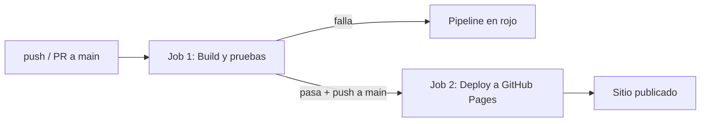

# Documentación del pipeline

Archivo: `.github/workflows/ci.yml` · Nombre: **CI/CD**

## Disparadores

| Evento | Qué ocurre |
|---|---|
| `push` a `main` | Corre el Job 1 y, si pasa, el Job 2 (deploy) |
| `pull_request` hacia `main` | Corre solo el Job 1 (valida antes de integrar; no despliega) |

## Permisos

`contents: read`, `pages: write` y `id-token: write`. Son los mínimos que necesita GitHub Pages; el resto queda denegado.

## Diagrama

## Job 1 — Build y pruebas (`build-test`)

| Paso | Qué hace | Por qué |
|---|---|---|
| `actions/checkout@v4` | Descarga el código en el runner | El runner empieza vacío |
| `actions/setup-node@v4` (Node 20) | Instala Node.js | Misma versión que el `Dockerfile` |
| `npm install` | Instala dependencias | Necesarias para pruebas y app |
| `npm run lint` | `node --check` sobre `src/` | Detecta errores de sintaxis temprano |
| `npm test` | Jest con cobertura y umbral mínimo | Si una prueba falla o la cobertura baja, el job termina en rojo |
| `upload-artifact` (`cobertura`) | Guarda `coverage/` | Permite descargar el reporte HTML, incluso si las pruebas fallan |
| `docker build` | Construye la imagen con el SHA del commit | Comprueba que el `Dockerfile` sigue siendo válido |

## Job 2 — Despliegue a GitHub Pages (`deploy-pages`)

- `needs: build-test`: solo corre si el Job 1 pasó.
- `if: github.ref == 'refs/heads/main' && github.event_name == 'push'`: nunca despliega desde un pull request.
- `configure-pages` → `upload-pages-artifact` (carpeta `public/`) → `deploy-pages`.
- La URL final aparece en el entorno `github-pages` del job.

## Cómo leer un fallo

1. Pestaña **Actions** → ejecución en rojo → job → paso con la ✗.
2. Abre el log del paso, corrige en local con `npm test` y vuelve a hacer push.
3. Si falló por cobertura, descarga el artefacto `cobertura` y abre `index.html`.

## Limitaciones conocidas

- GitHub Pages solo sirve archivos estáticos: la API Express no se despliega ahí (el frontend lo avisa).
- `package-lock.json` está en `.gitignore`, por eso se usa `npm install` y no `npm ci`.

